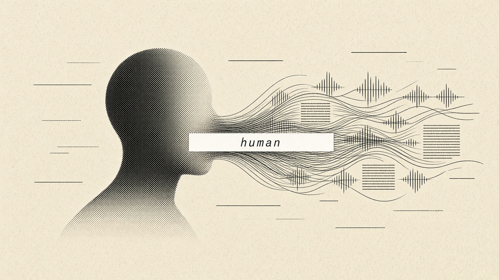
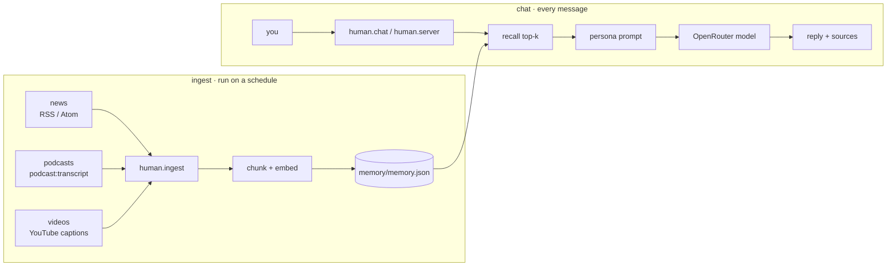

# human



A chatbot that's been reading. human pulls in the news, podcast transcripts and
video transcripts, keeps them in a local memory, and talks to you from what it
has absorbed. It's built to feel human to talk to.


> [!CAUTION]
> This is an experimental project. human is a persona: a language model, a
> prompt and a memory file. It has no feelings or inner life, and it doesn't
> know everything. It only knows what you've ingested, up to the last time you
> ran ingest. Don't rely on it for medical, legal or financial decisions.

## quick start

```bash
git clone https://github.com/YOUR-USERNAME/human.git
cd human
cp .env.example .env            # paste your OPENROUTER_API_KEY
python -m human.ingest          # read the feeds in config/sources.json
python -m human.chat            # talk
```

That's it. The core uses only the Python standard library, so there's nothing
else to install. `pip install -r requirements.txt` adds real YouTube
transcripts, which are optional.

> [!TIP]
> No API key yet? Run `python -m human.ingest --sample` and then
> `python -m human.chat`. It works fully offline in a basic quote-back mode,
> so you can see the memory pipeline working before you spend anything.

> [!NOTE]
> **Windows:** works with plain Python 3.10+. Use `py -m human.chat` if
> `python` isn't on your PATH, and `copy .env.example .env` instead of `cp`.

## what is human

Most chatbots either know nothing recent or go off and search the web every time
you ask something. human sits in between. It does its reading ahead of time and
answers from that.

1. **It reads.** `human.ingest` pulls RSS and Atom news feeds, podcast episodes
   through their published transcripts (the Podcasting 2.0
   `<podcast:transcript>` tag), and YouTube videos through their captions.
2. **It remembers.** Everything is chunked, embedded and stored in
   `memory/memory.json` on your own disk.
3. **It talks.** When you send a message, human pulls the few most relevant
   memories, puts them in its persona prompt, and makes one call to whichever
   model you chose on OpenRouter.

What you get:

- **Speed.** Answering is one local lookup plus one model call, with no live
  search on every question.
- **Personality.** The whole persona lives in one file, `human/persona.py`,
  and you can rewrite it however you like.
- **Honesty about sources.** Replies can point back to the article or episode
  they drew from, and the web UI links to them.
- **Any model.** Set `HUMAN_MODEL` to any OpenRouter model id. The default,
  `openrouter/auto`, picks one for you.

## how it works



| piece | file | what it does |
|---|---|---|
| ingest | `human/ingest.py` | fetches feeds, transcripts and captions, then dedupes |
| memory | `human/memory.py` | persistent vector store built on `rag_chatbot.VectorStore` |
| persona | `human/persona.py` | the system prompt, where the voice and the honesty rules live |
| brain | `human/brain.py` | recall, then prompt, then model, and back to you |
| llm | `human/llm.py` | OpenRouter chat completions client (stdlib `urllib`) |
| chat | `human/chat.py` | terminal chat |
| server | `human/server.py` + `human/web/` | minimal web chat with `/api/chat` and `/api/health` |
| landing | `docs/` | GitHub Pages site |

The embeddings are a local, offline hashing embedder (from upstream, with
stopword filtering added). That makes it fast, free and private, but it matches
on shared words rather than meaning. If you want semantic recall, swap
`HumanEmbedder` for a real embedding model behind the same `embed()` interface.

## setup guide

### 1. clone

```bash
git clone https://github.com/YOUR-USERNAME/human.git
cd human
```

### 2. install

You need Python 3.10 or newer. A virtualenv is recommended but not required.

```bash
python3 -m venv .venv
source .venv/bin/activate        # Windows: .venv\Scripts\activate
pip install -r requirements.txt  # optional, adds YouTube transcripts
```

### 3. configure `.env`

```bash
cp .env.example .env
```

| variable | default | |
|---|---|---|
| `OPENROUTER_API_KEY` | (none) | get one at <https://openrouter.ai/keys>. Without it, human runs offline |
| `HUMAN_MODEL` | `openrouter/auto` | any OpenRouter model id |
| `HUMAN_TOP_K` | `6` | memories pulled into each reply |
| `HUMAN_MEMORY_PATH` | `memory/memory.json` | where memory lives |
| `HUMAN_SOURCES` | `config/sources.json` | what human reads |
| `HUMAN_HOST` / `PORT` | `127.0.0.1` / `8787` | web chat bind address |

### 4. ingest

Edit `config/sources.json` to choose what human reads:

```json
{"type": "news",    "name": "BBC News - World", "url": "https://feeds.bbci.co.uk/news/world/rss.xml"}
{"type": "podcast", "name": "Some Show",        "url": "https://example.com/podcast.rss"}
{"type": "youtube", "name": "Some Channel",     "channel_id": "UC..."}
```

Then run:

```bash
python -m human.ingest --dry-run      # see what it would read and write nothing
python -m human.ingest                # read it for real (dedupes, safe to re-run)
python -m human.ingest --full-text    # also fetch full article pages for news
python -m human.ingest --note diary.md --title "my notes"   # add a local file
python -m human.ingest --reset        # forget everything and start over
```

To keep human current, run ingest on a schedule, for example with cron:

```cron
0 */3 * * * cd /path/to/human && .venv/bin/python -m human.ingest >> ingest.log 2>&1
```

### 5. chat

```bash
python -m human.chat               # terminal (/reset clears the conversation, /exit leaves)
python -m human.chat --sources     # show which memories each reply used
python -m human.server             # web chat at http://127.0.0.1:8787
```

### 6. deploy

The web chat is a single stdlib process, so anything that runs Python or Docker
can host it.

```bash
docker build -t human .
docker run -p 8080:8080 -e OPENROUTER_API_KEY=sk-or-... -v $PWD/memory:/app/memory human
```

On Render, Railway or Fly, point the service at this repo, use the Dockerfile,
set `OPENROUTER_API_KEY` as a secret, and attach a volume at `/app/memory` so
memory survives restarts. On a VPS, run `HUMAN_HOST=0.0.0.0 python -m human.server`
behind nginx or Caddy for HTTPS, and run ingest from cron.

> [!WARNING]
> `/api/chat` has no login or rate limit. A public URL spends your OpenRouter
> credit. Put it behind auth or a reverse-proxy rate limit, and set a spend
> limit on your OpenRouter key.

### 7. GitHub Pages (the landing site)

The landing page lives in `docs/`.

1. Push the repo to GitHub.
2. Go to **Settings → Pages**.
3. Under **Build and deployment**, choose **Source: Deploy from a branch**, then
   pick **Branch: `main`** and **Folder: `/docs`**, and click **Save**.
4. After a minute it's live at `https://YOUR-USERNAME.github.io/human/`.

Replace `YOUR-USERNAME` in `docs/index.html` (the GitHub link and the `og:image`
URL) and in this README.

## verify

```bash
python -m unittest                 # offline tests: parsing, memory, upstream RAG core
python -m human.ingest --dry-run   # live fetch check, writes nothing
pip install ruff && ruff check . && ruff format --check .
```

## faq

**Does it actually feel things?** No. It's written to be warm and to talk about
feelings well, because that's what it reads about. The persona prompt tells it
to say plainly that it's software when someone asks.

**Does it search the internet when I ask something?** No. It only searches its
own memory. That's why it's fast, and also why it can be out of date. Run
ingest more often to keep it current.

**Where does my data go?** Memory stays on your disk. Each message, the recalled
snippets and recent chat history go to OpenRouter and the model provider you
picked.

**Why are some videos only "description"?** Not every video has captions, and
YouTube sometimes blocks transcript requests from cloud IPs. In those cases
human falls back to the title and description.

## todos

- [x] RSS/Atom news, podcast transcripts, YouTube captions
- [x] offline mode and tests that need no keys
- [ ] optional semantic embeddings (OpenRouter or local sentence-transformers)
- [ ] streaming replies in the web UI
- [ ] long-term memory of conversations, with opt-in
- [ ] Whisper fallback for podcasts without published transcripts
- [ ] auth and rate limiting for the web chat

Contributions are welcome.

## support / donate

Running human costs real money: OpenRouter model calls for every message,
compute and bandwidth for reading feeds and transcripts every day, and hosting
for the chat. If you'd like to help cover those costs, you can send a donation
to any of these addresses.

**Solana**

```
6u6pQiXmpkAUa76uhHYNiic8HbV8srCr5CUymrHZe6nF
```

**EVM (ETH / Base / etc.)**

```
0xB1dA14ac36590440B3834A0F60f88B9b863fb7ce
```

**Bitcoin**

```
bc1q73y7vdrggstyafqf2xpyx0gh8f4glh204r4sm7
```


## credits

Based on [py-rag-chatbot](https://github.com/eduardk89/py-rag-chatbot) by
Eduard Kondratyev (MIT). Its dependency-free RAG core is vendored unmodified in
`rag_chatbot/`, with its license at `rag_chatbot/LICENSE`. See [NOTICE](NOTICE).

## license

MIT for new code (see [LICENSE](LICENSE)). The vendored `rag_chatbot/` keeps its
upstream MIT license.

<sub>built with insights bot</sub>
